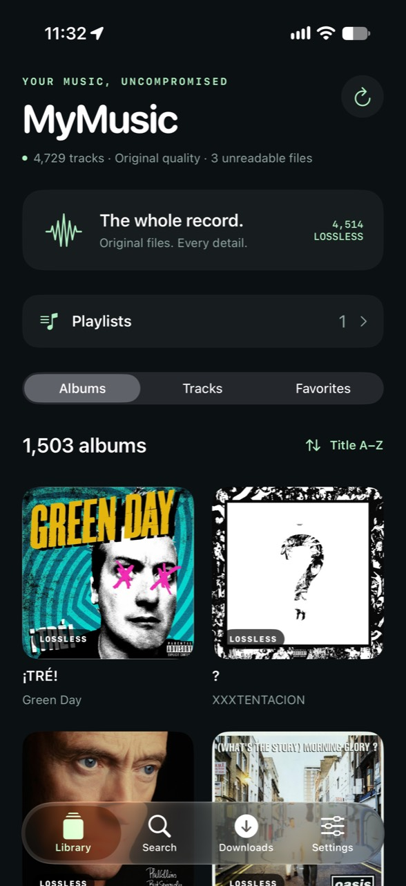
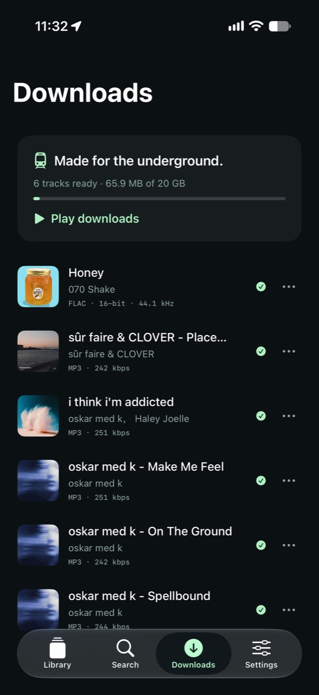
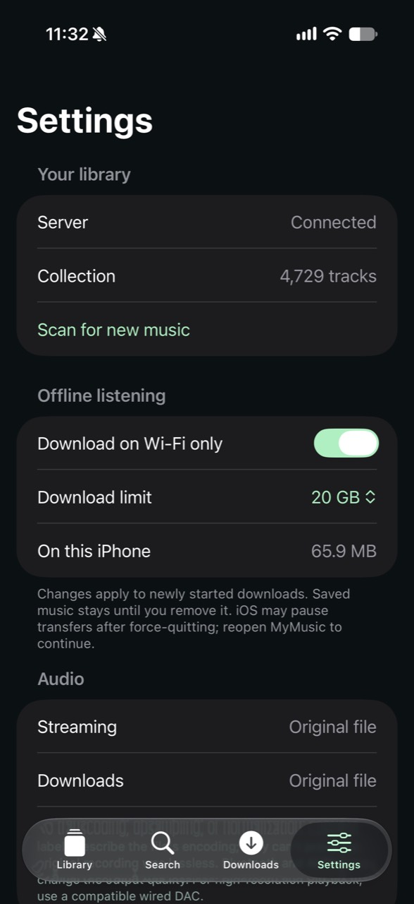

# MyMusic

A native iPhone music player for your own library. Stream original audio, save original files for the subway, and browse albums without a Plex subscription.

<table>
  <tr>
    <td></td>
    <td></td>
    <td></td>
  </tr>
</table>

## What works

- Native SwiftUI album library, embedded/folder artwork, track/artist/album search, and local favorites.
- Original FLAC, ALAC, WAV, AIFF, MP3, and AAC delivery; accurate encoding, bit-depth, and sample-rate labels. Unsupported/malformed files are skipped by the scanner or reported by the player.
- Native playback, seeking, queue, shuffle, repeat, lock-screen controls, audio interruption handling, headphone-disconnect pause, and an AirPlay route picker.
- Tap a track or Play once to start automatically when it is ready. The selected queue advances automatically; Play retries a failed track, and pausing during buffering cancels the pending playback intent.
- Background URLSession downloads with a persistent queue, Wi-Fi-only default, storage budget, incomplete-file rejection, and offline playback after relaunch. Saved files are not silently evicted.
- Read-only server music mount; a five-minute scan finds new files from any existing downloader. No Plex API, premium membership, transcoding, or changes to source files.
- Certificate-pinned TLS and bearer authentication for library, artwork, streaming, and downloads. Unauthenticated health check exposes only liveness.

Lossless describes the file encoding, not its provenance or the entire output chain. Converting an MP3 to FLAC cannot restore detail. Bluetooth/AirPlay may change output quality; use a suitable wired DAC for high-resolution output. This version does not promise gapless playback, crossfade, CarPlay, automatic phone downloads of newly added tracks, or remote access outside your home network. Download before leaving home; an existing private VPN can provide remote access if it routes to the library server.

## Local build

Requires Xcode and iOS 17+. Copy `ios/Config/Local.example.xcconfig` to ignored `ios/Config/Local.xcconfig` and set your bundle ID and Apple team. Open `ios/MyMusic.xcodeproj`, select **MyMusic**, and run on an iPhone simulator.

The private `ios/MyMusic/Connection.plist` is produced by the pairing script and bundled only in your personal app. It contains the server URL, bearer token, and exact certificate fingerprint. Do not distribute this build or publish that file. Shared source contains no personal pairing secrets.

The project lives at `~/projects/my-music`. The personal build keeps its existing provisioned bundle identifier so installing MyMusic updates the existing app. On first launch, existing Undertone downloads and library state move into the MyMusic application-support folder. The companion's existing `UNDERTONE_*` environment names and Compose identity remain compatible with the deployed server; renaming the app does not rotate pairing credentials or redeploy the service.

## Library server

Python 3.12+ or Docker. Set `UNDERTONE_TOKEN` to a random token of at least 32 characters, `MUSIC_ROOT` to the music directory, and `STATE_ROOT` to a writable metadata directory.

For a private LAN deployment:

```sh
python3 scripts/prepare.py --host YOUR_SERVER_LAN_IP --music-path /YOUR/MUSIC/FOLDER
python3 scripts/deploy.py --ssh root@YOUR_SERVER --identity ~/.ssh/YOUR_KEY --directory /YOUR_APPDATA/undertone
python3 scripts/verify.py
```

Pair once. `prepare.py` replaces the certificate, so running it again requires deploying the server and rebuilding all paired apps. Deployment sends an explicit allowlist; it does not send test media or existing catalog state. The Docker service is capped at half a CPU core, 384 MB memory, and 64 processes, with no writable music access. Port 8448 binds to the supplied LAN address. Do not expose it publicly.

The initial scan reads metadata across the library and publishes every 50 tracks; later scans reuse metadata for unchanged files. New files modified within 30 seconds are deferred to the next scan. The source must remain available and unchanged during playback/downloads. Files that change get a new identity. Old downloaded copies remain independently playable.

## iPhone installation

Sign in to your Apple developer account in **Xcode → Settings → Accounts**. The existing signing identity alone does not authorize a new app ID. Pair your phone with Xcode, enable Developer Mode, and keep the Mac and iPhone on the same network. Then:

```sh
xcrun devicectl list devices
bash scripts/install-iphone.sh YOUR_DEVICE_ID
```

This installs a development build wirelessly on a paired device. It is not an App Store/TestFlight release. Its provisioning profile has an expiry date; rebuild and reinstall before expiry. iOS can delay background downloads, and force-quitting may suspend them until the app reopens.

## Validation

```sh
python3.12 -m venv .venv
.venv/bin/python -m pip install -r server/requirements.lock
.venv/bin/python -m unittest discover -s server -p test_app.py -v
python3 scripts/verify.py
xcodebuild -project ios/MyMusic.xcodeproj -scheme MyMusic \
  -destination 'platform=iOS Simulator,id=YOUR_SIMULATOR_ID' \
  -derivedDataPath .build -parallel-testing-enabled NO test
```

Server tests use generated WAV files in isolated temporary directories. Live verification checks the pinned certificate before sending authentication, downloads a real FLAC, and compares HTTP byte ranges. UI tests currently use tracks titled “Let It Go”, “Heaven”, and Pink Floyd’s “Breathe (In the Air)” from the connected personal library. The offline test blocks the entire API in simulator builds using `--test-offline`, then plays a completed download after relaunch. This override is compiled out of physical-device builds. A separate test plays 24-bit / 192 kHz FLAC and verifies playback continues through a background/foreground cycle. Tests retain screenshots in their `.xcresult` bundles.

## SoundCloud / n8n

MyMusic reads the existing music folder. When an existing workflow saves a completed audio file there, it appears in MyMusic on the next scan/refresh. The SoundCloud likes downloader itself has not been recreated: the inspected running n8n instance has no SoundCloud workflow in its current workflows or recorded workflow history. Its location/account still needs to be identified. Preserve the artist-provided original when available; label transcoded streams as their actual compressed format.

See [SECURITY.md](SECURITY.md) for pairing-file handling, credential rotation, and security checks.
